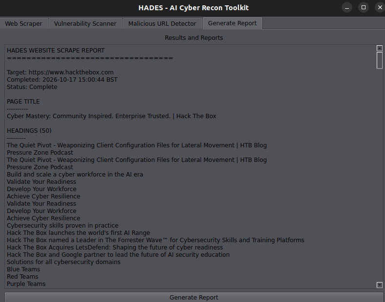

# HADES - AI Cyber Recon Toolkit GUI

<p align="center">
  
</p>

## Overview
HADES is an AI Cyber Recon Toolkit designed to assist users in web scraping, vulnerability scanning, malicious URL detection, and report generation. This GUI application provides a user-friendly interface to access the functionalities of the toolkit.

## Features
- **Web Scraper**: Easily scrape data from websites by entering the target URL.
- **Vulnerability Scanner**: Scan for vulnerabilities on specified IPs or domains.
- **Malicious URL Detection**: Analyze URLs to determine if they are safe or malicious.
- **Report Generation**: Generate comprehensive reports based on the performed tasks.

## Installation
1. Clone the repository:
   ```
   git clone <repository-url>
   cd hades-gui
   ```

2. Install the required dependencies:
   ```
   pip install -r requirements.txt
   ```

## Usage
To run the application, execute the following command:
```
python main.py
```

### Example Usage

Enter a website URL in the **Web Scraper** tab and select **Scrape Site**. After the scrape completes, choose **View Results in Report Tab** to review the page title, headings, links, and paragraphs.

This screenshot shows a successful scrape of Hack The Box:



## Project Structure
```
hades-gui
├── src
│   ├── gui
│   │   ├── main_window.py
│   │   ├── scraper_tab.py
│   │   ├── scanner_tab.py
│   │   ├── detector_tab.py
│   │   └── report_tab.py
│   ├── input_handler.py
│   ├── scraper
│   │   └── site_scraper.py
│   ├── scanner
│   │   └── vuln_scan.py
│   ├── models
│   │   └── malicious_url_classifier.py
│   └── utils
│       └── __init__.py
├── requirements.txt
├── main.py
└── README.md
```

## Contributing
Contributions are welcome! Please submit a pull request or open an issue for any enhancements or bug fixes.

## License
This project is licensed under the MIT License. See the LICENSE file for details.
